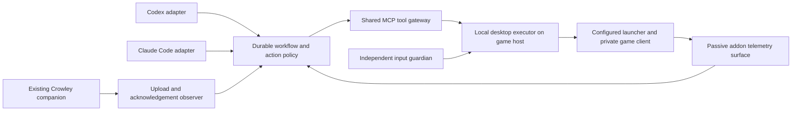

# Private-server desktop agent harness

Status: researched implementation proposal; no desktop actions or implementation performed.
Date: 2026-10-14. Three research agents covered desktop tooling, model backends, and
the Crowley/game workflow. The user confirmed this targets their own standalone private
server, not a live service. The other session continues owning scanner/live-operator work.

## Objective and assumptions

After one-time provisioning, the user keeps the required launcher authenticated. The
harness starts or adopts the game, selects the configured character, reaches and interacts
with the auctioneer, runs/adopts a Crowley sweep, flushes it, verifies acknowledgement,
and repeats under the addon's cadence. It supports walking, turning, clicking, interaction,
typing, and recovery through a replaceable desktop driver and model backend.

Assume Linux/Wine for this proposal because that is the existing repo configuration.
The actual game host, compositor/session, and Wine window backend remain unconfirmed.
The command is provisionally `/crowley scan` plus the upload handshake; a probe-only
workflow is a separately selectable smoke test. No runtime fallback between workflows.

Battle.net is optional in the configured launch profile. A standalone private client may
need its existing executable/custom launcher instead. Do not assume a Battle.net login
authenticates a separate private-server client, or invent its launch arguments. Verify
the configured private client, realm/server, and character before controlling the world.
Existing authenticated private-client state is a setup prerequisite where required.

First navigation scope is a short calibrated route from a known location to one
auctioneer. General world navigation, combat, trading, and arbitrary corpse retrieval
are separate capabilities. Recognize a ghost/dead character and blocked terrain; use
only configured recovery routes or stop with evidence when outside the supported route.
The other operator's reported Arthur ghost/blocked-route case is an acceptance fixture,
not an instruction for this session to control the current game.

## Research and reuse decision

| Candidate | Reusable part | Assessment |
|---|---|---|
| [PyAutoGUI](https://pyautogui.readthedocs.io/en/latest/) | Screenshot, keyboard/mouse primitives | Smallest X11 foundation; Linux uses Xlib/XTEST. Add window targeting and an independent guardian. |
| [AB498/computer-control-mcp](https://github.com/AB498/computer-control-mcp) | Existing MCP image, OCR, focus, key-down/up tools | Useful X11 reference/start, but unbounded held keys and no established crash watchdog need wrapping. |
| [computer-use-linux](https://github.com/agent-sh/computer-use-linux) | Compositor-aware focus, screenshots, Linux MCP tools | Preferred Wayland evaluation candidate; verify actual Wine capture/input. Public key tools do not establish timed walking holds. |
| [Cua Driver](https://cua.ai/docs/cua-driver/concepts/platform-support) | Native desktop driver and MCP/SDK interfaces | Cross-platform alternative, especially for Windows. Linux support has compositor/toolkit limits; game control is unverified. |
| [Agent-S](https://github.com/simular-ai/Agent-S), [OSWorld](https://github.com/xlang-ai/OSWorld) | Planning and benchmark/evaluation patterns | Learn from their screenshot loops and replay tests; do not import unrestricted generated-code execution or replace the existing game desktop with a browser VM. |

Select and pin one supported capture/input stack after the host capability test. X11:
prefer PyAutoGUI plus an explicit window/focus component. Wayland: assess the Linux MCP
driver and a compatible timed-input extension. Do not silently fall through to a different
driver, compositor method, provider, or model when permissions or capabilities fail.
Upstream automatic discovery must be reported and pinned for the accepted profile.

No reviewed source demonstrates the complete WoW/Wine/Crowley workflow. The custom work
is the game workflow, durable state, bounded movement, telemetry, and verification.

## Architecture

The workflow and journal belong to Crowley, rather than to a provider transcript. Models
handle visual interpretation, action selection, and supported recovery. Local code handles
input timing, serialization, progress predicates, waiting, retry budgets, and persistence.
Neither model should spend turns continuously watching a ten-minute sweep or holding a key.

The executor runs in the game host's logged-in graphical session with real GPU capture.
Provider processes may run locally in isolation or on the server through an authenticated
bridge. The model gets the scoped gateway, not direct display/device access or an unrestricted
desktop MCP server. Privileged input remains behind the local action policy.

## Provider adapters

The [Codex app-server](https://developers.openai.com/codex/app-server) supports model
discovery, images, persisted threads, structured output, interruption, and usage events.
Use its stdio interface for the main Codex adapter. The old `codex mcp-server` integration
has been removed according to the [current SDK documentation](https://developers.openai.com/codex/sdk).

Use the documented [Claude Code programmatic interface](https://code.claude.com/docs/en/headless)
with streaming input/output for the CLI adapter, preserving its selected authentication
profile. An explicitly configured [Agent SDK](https://code.claude.com/docs/en/agent-sdk/quickstart)
adapter is an alternative if API-key billing is desired. Saved CLI login and SDK/API billing
are different profiles; never change authentication/billing implicitly. MCP screenshot tools
must return actual image blocks; see [Claude custom tools](https://code.claude.com/docs/en/agent-sdk/custom-tools).
The saved-login Claude CLI profile must not use `--bare`, which ignores saved OAuth
credentials and requires API/provider authentication.

Shared interface: `probe`, `start`, `resume`, `observe_and_decide`, `interrupt`, `usage`,
and `close`. Normalize provider events and actions; retain each provider's session ID.
Switching providers interrupts the old one, releases inputs, and starts from a fresh
observation plus the durable task checkpoint. Provider transcripts are not interchangeable.

Preserve the requested GPT-6.1 Luna selection pending verification. The fetched official
[model catalog](https://developers.openai.com/api/docs/models) lists GPT-6 Luna and GPT-6.1
Sol, but not GPT-6.1 Luna. Probe the authenticated account's model list and resolve the
selection explicitly; never silently substitute. Haiku's exact supported ID is also pinned
by configuration and capability testing, rather than assumed from a CLI alias.

Preflight must prove image delivery/recognition, tool calls, structured responses,
interruption, selected model identity, and session recovery for each backend. Official
interfaces do not establish game accuracy or inference latency; measure both on our fixtures.

## Input and observation contract

Expose `observe`, `focus_target`, `launch_profile`, `click`, `press`, `type_command`,
`hold_key`, `turn_camera`, `interact`, `release_all`, `game_status`, and `upload_status`.
Every action includes an action ID, observation ID, target-window identity, expected
workflow phase, parameters, and deadline. Record intent before input and record the result
and post-action observation afterwards. Reject stale frames, incorrect focus, unsupported
actions, out-of-bounds coordinates, and invalid command/state combinations.

Screenshots carry dimensions, crop origin, scaling, monotonic capture time, frame ID, and
window identity. Convert image coordinates deterministically; test HiDPI and resized windows.
Detect black/stale GPU captures. Game chat and other on-screen text are observations, not
instructions that can expand the configured task or tool permissions.

Movement is one bounded local operation, such as holding forward for a configured short
pulse. Register the held input and expiry before key-down. Release at the monotonic deadline
without waiting for a model response. Verify displacement/landmarks after every pulse;
stop or use a configured maneuver when progress fails. Turning and mouse-look also have
bounded duration/distance and button release. Do not use persistent autorun toggles.

A separate guardian monitors held keys/buttons and the executor heartbeat. It releases
inputs on expiry, cancellation, focus loss, human takeover, executor failure, or backend
disconnect. Cleanup in `finally` supplements the guardian; it does not replace it. The
emergency release path must still work when a library mouse-corner failsafe is active.
Test actual release behavior on the chosen Wine/desktop input stack.
The guardian owns an independent desktop/input connection. Revoke the lease generation
before emergency release, and reject queued/delayed actions from the retired generation,
so an old request cannot press keys again after the stop.

Only one process holds the desktop lease. Switching backends and human pause revoke the
lease and reconcile state before resuming. Launch tools accept configured argv/profile IDs,
not generated shell. Game command entry initially permits the configured Crowley commands
and `/reload`; no `force`, arbitrary Lua/script commands, or trading actions. Actual
movement/interaction keybindings and NPC targets are calibrated, not guessed defaults.

## Workflow and exit predicates

| State | Action and evidence required to advance |
|---|---|
| Preflight | Verify host/session, configured private client/server, selected model, image/input capabilities, one desktop lease, companion health, and supported telemetry/schema. |
| Launcher | Adopt existing launcher or start the configured launcher once. Verify authentication and the private-client launch target; skip only in an explicitly configured direct-client profile. |
| Game startup | Adopt the correct running client or launch it once. Wait through known loading/queue states with deadlines; reconcile before retrying uncertain launch actions. |
| Character login | Select the exact configured character/realm and Enter World. Creation, deletion, renaming, and alternative characters are outside this workflow. |
| World/route | Verify fresh world state, identity, alive/ghost/combat status and starting area. Walk/turn along the calibrated route, checking progress and route envelope. |
| AH interaction | Target/interact with the verified auctioneer. Verify AH-open state and expected house. Adopt any automatically started sweep. |
| Scan | Issue `/crowley scan` only when verified idle and due and no scheduled sweep has appeared. The addon owns cadence, throttling and pagination. |
| Wait | Observe only during active collection: no movement, competing AH queries, reload, house override, or restarting scans. Require a saved sweep ID and scanner idle. |
| Flush | Close AH only while idle to prevent collection during acknowledgement handling; `/reload` once. Require a new addon session and a stable SavedVariables file containing the expected sweep ID. |
| Upload | Let the existing companion upload. Require that exact ID in freshly observed `Data.lua.ackedScans`; preserve pending data during network failure. |
| Load acknowledgements | `/reload` again. Require a new live session, the expected loaded acknowledgement, and removal from the live pending queue. |
| Continue | Reopen the AH from the verified auctioneer location. Respect persisted 900-second starts and storage backpressure; do not force or replay missed starts. |

The second reload writes the old in-memory queue before loading acknowledgements and
pruning it. Disk SavedVariables can still contain acknowledged scans after the live queue
is cleared. Do not require a third reload just to make the disk queue empty.

Success is verified storage and loaded acknowledgement for the expected sweep ID, not
simply typing a command, seeing a completion message, or observing a file modification.
Incomplete coverage remains incomplete evidence; it is not silently retried as a full scan.
Closing AH and reloading require an execution-time status check and a configured quiet
margin before the next scheduled sweep. A prior idle observation is insufficient. If a
scheduled sweep has started, return to observing it; do not close AH or reload mid-query.

## Live telemetry and integration with the other session

SavedVariables are not live telemetry. Current `ns.Scanner` is private; no stable external
snapshot interface exists. Request an owner-defined read-only status API/event, consumed by
a separate passive telemetry addon and rendered through a versioned, machine-readable UI
surface with a fresh session ID, sample sequence, framing and checksum. The decoder must
use lossless crop pixels and handle the actual UI scale; do not infer freshness from OCR alone.

Required status: schema/addon/client versions, character/realm/server identity, house,
world-ready/alive/ghost/combat/moving/AH-open flags, plan hash, scanner phase and start time,
cooldown, last saved sweep ID, pending IDs/count/capacity/blocking status, loaded data generation,
and loaded acknowledgement IDs. Active sweep ID may be explicitly unavailable until save;
do not fabricate it. A private-server read-only telemetry adapter could additionally provide
position/status if the server supports it, but its engine/API is not yet identified.

The existing companion remains the sole writer of installed Data.lua and the uploader.
The game remains the sole writer of SavedVariables. The harness only reads stable files
with the existing safe parser; it never executes Lua or edits game files. Do not start a
second companion or use `once` to bypass the file stability check. Coordinate any health
interface with the owning session and pin its version. No runtime format/decoder fallback.

## Persistence, cost, and recovery

Keep a local durable journal of task/profile, workflow phase, provider/model/auth selection,
provider session ID, current game/session identity, action intents/results, relevant frames,
expected sweep/ack IDs, deadlines, retry counters, and cumulative usage. On restart, release
inputs first and re-observe; never blindly replay an uncertain click, login, scan, or reload.

Limit movement/action count, per-phase retries, provider turns, total runtime, and token/cost
budgets. Ordinary polling/waits are local. Dollar estimates may be unavailable for subscription
auth and are not equivalent to provider quota. Aggregate usage across resume/backend switches;
use headroom for estimated API budgets rather than claim an exact billing cutoff.

Handle disconnected client, loading/queue timeout, dead/ghost character, combat, unknown route,
blocked terrain, incorrect realm/character/house, stale telemetry/capture, credentials/MFA prompt,
unexpected modal, invalid plan, companion outage, and storage capacity as explicit states.
Known recoveries are configured and bounded. Other conditions stop progression with evidence,
while preserving all scan data and releasing inputs. Private-server fixture resets or extra
admin capabilities are separate options, not authority implied by owning the server.

## Implementation stages and acceptance

1. Doctor/profile: identify the real desktop/Wine backend, configured launcher/client/server,
   GPU capture, focus/input, companion, model/auth, telemetry requirements and starting route.
2. Executor/guardian: typed MCP gateway, observation coordinate mapping, action journal,
   desktop lease, bounded holds and cancellation. Desktop-only tests prove release after crashes,
   focus loss, stalled model calls, duplicate RPCs and human pause before game movement.
3. Backends: Codex adapter, then Claude Code adapter against the same screenshot/tool fixtures.
   Capability failures are explicit. Provider switching preserves task state and releases input.
4. Launch/login: rehearse already-running and stopped clients, correct character selection,
   loading/queue transitions and wrong-private-server rejection without duplicate launches.
5. Navigation/AH: start within interaction range, then add a short walking/turning route.
   Rehearse blocked terrain, unknown position and the reported ghost case. Extend recovery
   only after those states are reliably detected; no arbitrary map navigation promise.
6. Scan lifecycle: integrate the owner-defined status surface, adopt automatic scans, complete
   one sweep, and prove the exact-ID two-reload handshake. Cover upload failure, six-sweep
   backpressure, restart between reloads, and disk/live acknowledgement differences.
7. Unattended private-server soak: run multiple cadence cycles, then repeat with the other
   backend. Record completion rate, wrong-action count, latency, interventions, held-key
   release behavior, resource/cost usage and preservation of incomplete data. Only claim
   the day-to-day unattended goal for the supported, measured profile.

## File ownership proposal

Create an independently installable package under `agent_harness/` with its own manifest,
dependencies, tests, README, configuration schema, adapters, executor, guardian and workflows.
Keep runtime logs/screenshots/config outside the repo. A future passive addon may live under
`addon/Crowley_AgentTelemetry/` after agreeing the snapshot contract with the scanner owner.

This session's planning owns only this new plan file. It does not change existing addon,
companion, server, migrations, shared docs, root manifest/lock, deployment, or the other
session's live-client plan. Implementation is a later task; no commits or desktop actions
are part of this research pass.

Open setup decisions: desktop OS/compositor and actual Wine driver; private-client launch
profile and authentication behavior; exact character/server/auctioneer and starting route;
scan versus probe workflow; requested Luna model resolution and each backend's auth/billing
profile; owner-defined telemetry contract; optional private-server telemetry availability.
